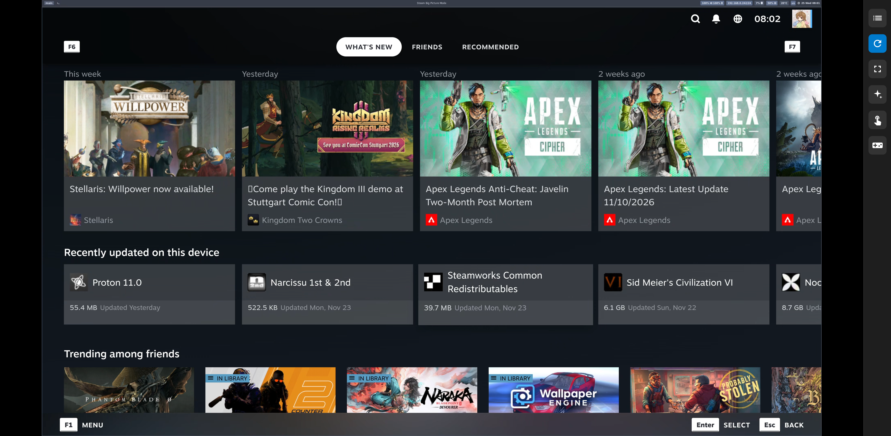
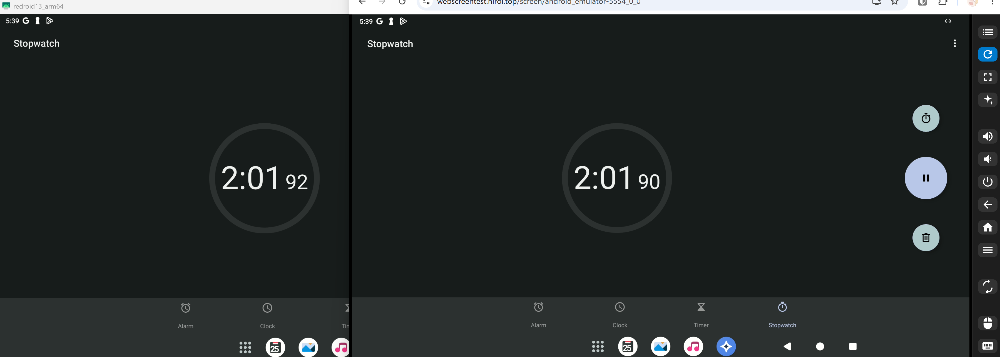

```markdown
<div align="center">

# 📺 Webscreen

Android、Linux および GameStream デバイス向けのセルフホスト型画面ストリーミング Web アプリケーション。

[](https://github.com/huonwe/webscreen/releases)
[](https://github.com/huonwe/webscreen/stargazers)
[](https://github.com/huonwe/webscreen)
[](https://www.gnu.org/licenses/agpl-3.0)

[English](README.md) • [简体中文](README.zh.md)

<br/>

**[▶️ デモ動画を見る (Android)](https://youtu.be/6WtbwaIk2aY)**
**[▶️ デモ動画を見る (Orangepi5Plus HDMI入力)](https://youtu.be/XMpHG3clOMU)**


</div>




## ✨ 主な機能

Webscreen は **Android Termux**、**Linux**、**Windows**、および **MacOS**（`amd64` と `arm64` の両方）で動作します。今後さらに多くのデバイスに対応する予定です！

### 🌟 共通機能
- 超解像（Super Resolution / HTTPS が必要）
- H.264 / H.265
- マルチ接続
- WebRTC / WebSocket ストリーミング
> **注意**：WebSocket を選択する場合は HTTPS が必須となります。

### ☀️ GameStream ([Sunshine](https://github.com/SunshineStream/Sunshine) / [Wolf](https://github.com/games-on-whales/wolf))
- 映像、音声、操作
- H.264 / H.265
- タッチ、マウス、キーボード対応
> [Quickstart with Wolf](doc/quick-start-wolf.md)

### 📱 Android（[scrcpy](https://github.com/Genymobile/scrcpy) 経由）
- 映像、音声、操作
- UHID デバイス（マウス、キーボード、ゲームパッド）
- クリップボード同期（HTTPS が必要）
- タッチ操作（マルチタッチ、筆圧感知）
> [Quick Start with Redroid](doc/quick-start-redroid.md)

> **注意**：Android 用 APK（要 root）および FnOS 用 fpk については、[youyoudezhuzhu/webscreen](https://github.com/youyoudezhuzhu/webscreen) をご参照ください。

### 🐧 Linux（Xvfb / Xorg / Sway）
- 映像、操作
- タッチ操作
- GPU サポート（Xorg / Sway）

### 🛹 rk3588-hdmirx（OrangePi 5 Plus Armbian ベンダーカーネルで動作確認済み）
- HDMI 入力の映像ストリーミング
- RKMPP ハードウェアエンコードによる H.264 / H.265
- *注意：音声にはまだ対応していません。*

---

## 🛠️ 前提条件

### クライアント側
WebRTC（H.264 High Profile または H.265 Main Profile）に対応したモダンな Web ブラウザが必要です。

### サーバー / デバイス側
Android デバイスの場合は、[scrcpy の前提条件](https://github.com/Genymobile/scrcpy/blob/master/README.md#prerequisites) を参照してください。

Windows、Linux、MacOS、および Termux で Android デバイスをストリーミングするには、少なくとも環境変数 `PATH` に `adb`（ディストリビューションによっては `adb` を提供する `android-tools`）が含まれている必要があります。プログラムが `adb` を見つけられない場合は自動的にダウンロードを試みます。また、Linux のヘッドレス仮想デスクトップを使用したい場合は、`ffmpeg`、`xvfb`、`xfce4`、`sway`、`wf-recorder` が `PATH` に通っていることを確認してください：
```bash
sudo apt install adb

# Linux のディスプレイをストリーミングする場合：
sudo apt install xvfb ffmpeg xfce4 sway wf-recorder seatd

```

> **注意**：Xorg を使用する場合は、本プログラムを root 権限で実行する必要がある場合があります。

> **注意**：Sway を使用する場合は、`wf-recorder` が使用されます。

> **注意**：キーボードとマウスのパススルーを利用するには、いずれの環境でも `uinput` と `seatd`、および適切な権限設定が必要です。

#### rk3588 HDMI 入力の要件

* HDMI RX をサポートするベンダーカーネル（`rk3588-hdmirx` が有効化されていること）。
* RKMPP をサポートする FFmpeg ビルド（例：`/usr/lib/jellyfin-ffmpeg/ffmpeg`）。
* MPP サービスに対する適切な読み書き権限：`sudo chmod 666 /dev/mpp_service`。
* システムパッケージ `v4l-utils`。

---

## 🚀 使い方

### 方法 1：ビルド済みバイナリを使用

[Releases](https://github.com/huonwe/webscreen/releases) ページから最新のバイナリをダウンロードします。
```bash
mkdir ./data
curl -fsSL https://raw.githubusercontent.com/huonwe/webscreen/main/config.yml -o ./data/config.yml
# You might need to change some settings here.
```

```bash
./webscreen -D ./data

```

その後、ブラウザを開いて `http://<あなたのIP>:8081` にアクセスしてください。

### 方法 2：ソースからビルド

通常は、`make` を実行するだけでビルドできます。

> **Termux に関する注意**：Termux 上でネイティブビルドを行う場合は、`go build -ldflags "-checklinkname=0"` を実行する必要があります。

```bash
git clone [https://github.com/huonwe/webscreen.git](https://github.com/huonwe/webscreen.git)
cd webscreen
make

```

### 方法 3：Docker を使用

```yaml
services:
  webscreen:
    image: dukihiroi/webscreen:latest
    container_name: webscreen
    network_mode: host
    restart: unless-stopped
    volumes:
      - /dev/bus/usb:/dev/bus/usb
      - ./data:/webscreen/data
    privileged: true


```

> 💡 **ヒント：** WebRTC の UDP トラフィックおよび USB デバイス接続の安定性のため、`host` ネットワークモードの使用を強く推奨します。

#### Android デバイスのペアリング

最初に [ワイヤレスデバッグ](https://developer.android.com/studio/debug/dev-options#enable) を使用して Android デバイスをペアリングする必要がある場合があります（「ペア設定コードによるデバイスのペア設定」に対応しています）。ペアリング完了後、Web UI 上の **Connect** ボタンをクリックしてください。
*注意：ストリーミング開始後に画面が真っ黒な場合は、画面表示に変化を与える操作（物理音量ボタンを押すなど）を行うと、フレームが強制的に更新されます。*

---

## 📖 ドキュメント

* [Redroid クイックスタート](doc/quick-start-redroid.md)
* [開発者向けドキュメント](doc/dev)

---

## ❓ よくある質問 (FAQ)

**Q: カスタム Android デバイスで `MediaCodec 0x80001001 Exception` エラーが発生してクラッシュします。**

* これは通常、H.264 High Profile（`profile=8`）が原因で発生します。
* **解決策**：`video_codec_options` で `profile=1` を設定してください。

---

## 🤝 謝辞

* 接続関連のバグを修正してくださった [@Enterpr1se0](https://github.com/Enterpr1se0) 氏と [@rogniceguy-max](https://github.com/rogniceguy-max) 氏に深く感謝いたします！
* 未使用の sdriver リソース解放バグの修正と Android ADB マネージャーの追加をしてくださった [youyoudezhuzhu/webscreen](https://github.com/youyoudezhuzhu/webscreen) に深く感謝いたします！
* 超解像機能の実装にあたり [websr](https://github.com/sb2702/websr) を利用させていただきました。

## 📄 ライセンス

このプロジェクトは **GNU Affero General Public License v3.0** のもとで公開されています。
