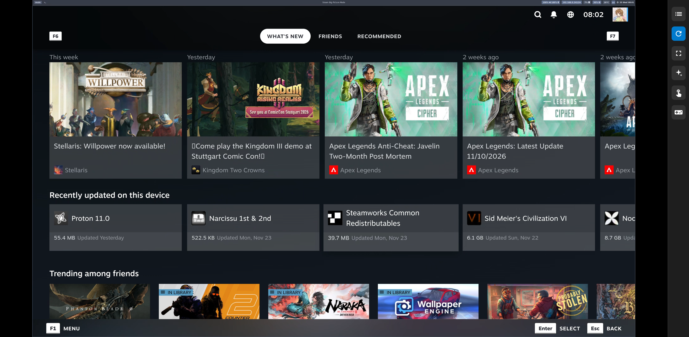

<div align="center">

# 📺 Webscreen

A self-hosted screen streaming web application for Android, Linux, and GameStream devices. 

[](https://github.com/huonwe/webscreen/releases)
[](https://github.com/huonwe/webscreen/stargazers)
[](https://github.com/huonwe/webscreen)
[](https://www.gnu.org/licenses/agpl-3.0)

[简体中文](README.zh.md) • [日本語](README.jp.md)

<br/>

**[▶️ Watch Demo Video (Android)](https://youtu.be/6WtbwaIk2aY)**
**[▶️ Watch Demo Video (Orangepi5Plus HDMI-in)](https://youtu.be/XMpHG3clOMU)**


</div>




## ✨ Features

Webscreen can run on **Android Termux**, **Linux**, **Windows**, and **MacOS** (both `amd64` and `arm64`). It might support more devices in the future!

### 🌟 Universal
- Super Resolution (HTTPS required)
- OCR Translate (LLM Endpoint required)
- H.264 / H.265
- Multi-Connection
- WebRTC / WebSocket Streaming
> **Note**: If you choose WebSocket, HTTPS is required.

### ☀️ GameStream ([Sunshine](https://github.com/SunshineStream/Sunshine) / [Wolf](https://github.com/games-on-whales/wolf))
- Video, Audio, Control
- Touch, Mouse, Keyboard
> [Quickstart with Wolf](doc/quick-start-wolf.md)

### 📱 Android ([scrcpy](https://github.com/Genymobile/scrcpy))
- Video, Audio, Control
- UHID Devices (Mouse, Keyboard, Gamepad)
- Clipboard Sync (HTTPS required)
- Touch (Multi-finger, pressure)
> [Quickstart with Redroid](doc/quick-start-redroid.md)


> **Note**: For Android apk (rooted) and FnOS fpk, you might see [youyoudezhuzhu/webscreen](https://github.com/youyoudezhuzhu/webscreen).

### 🐧 Linux (Xvfb / Xorg / Sway)
- Video, Control
- Touch
- GPU support (Xorg/Sway)

### 🛹 rk3588-hdmirx (OrangePi 5 Plus Armbian vendor kernel tested)
- HDMI-in video streaming
- H.264 / H.265 with RKMPP hardware encoding
- *Note: Audio is not supported yet.*

---

## 🛠️ Prerequisites

### Client Side
You need a modern web browser that supports WebRTC (H.264 High Profile, or H.265 Main Profile).

### Server / Device Side
For Android devices, please refer to the [scrcpy prerequisites](https://github.com/Genymobile/scrcpy/blob/master/README.md#prerequisites). 

For Windows, Linux, MacOS, and Termux, you need `adb` (or `android-tools` in some distributions, which provides `adb`) in your PATH at least to stream Android devices. If the program didn't found `adb`, it will try to download it. Optionally, if you want to use Linux headless virtual desktop, make sure `ffmpeg` `xvfb`, `xfce4`, `sway`, and `wf-recorder` are in your `PATH`:
```bash
sudo apt install adb

# If you want to stream the Linux display:
sudo apt install xvfb ffmpeg xfce4 sway wf-recorder seatd
```

> **Note**: If you want to use Xorg, you might need to run this program as root.

> **Note**: If you want to use Sway, `wf-recorder` is used.

> **Note**: All of them need `uinput` and `seatd` and correct permissions if you want to have keyboard and mouse passthrough.


#### rk3588 HDMI-in Requirements

* A vendor kernel with HDMI RX support (`rk3588-hdmirx` enabled).
* An FFmpeg build with RKMPP support (e.g., `/usr/lib/jellyfin-ffmpeg/ffmpeg`).
* Correct read/write permissions for MPP service: `sudo chmod 666 /dev/mpp_service`.
* System package `v4l-utils`.

---

## 🚀 Usage

### Option 1: Use Pre-built Binary

Download the latest binary from the [Releases](https://github.com/huonwe/webscreen/releases) page.

Then,
```bash
mkdir ./data
curl -fsSL https://raw.githubusercontent.com/huonwe/webscreen/main/config.yml -o ./data/config.yml
# You might need to change some settings here.
```

```bash
./webscreen -D ./data
```

Then open your browser and visit: `http://<your-ip>:8081`

### Option 2: Build from Source

Normally, you can build simply by running `make`.

> **Termux Note**: If building natively on Termux, you must run `go build -ldflags "-checklinkname=0"`.

```bash
git clone https://github.com/huonwe/webscreen.git
cd webscreen
make
```

### Option 3: Docker

```yaml
services:
  webscreen:
    image: dukihiroi/webscreen:latest
    container_name: webscreen
    network_mode: host
    restart: unless-stopped
    volumes:
      - /dev/bus/usb:/dev/bus/usb
      - ./data:/webscreen/data
    privileged: true

```


> 💡 **Tip:** `host` network mode is highly recommended due to WebRTC UDP traffic and USB device connection stability.

#### Android Pairing

You might need to pair your Android device via [Wireless Debugging](https://developer.android.com/studio/debug/dev-options#enable) first. "Pair device with pairing code" is supported. Once paired, click the **Connect** button in the web UI.
*Note: After starting the stream, if the screen is black, simply trigger a UI change (e.g., press the physical volume button) to force a frame update.*

---

## 📖 Documentation

* [For Developers](doc/dev)

---

## ❓ FAQ

**Q: Crash: `MediaCodec 0x80001001 Exception` on custom Android devices?**

* This is usually due to the H.264 High Profile (`profile=8`).
* **Fix**: Set `profile=1` in `video_codec_options`.

---

## 🤝 Acknowledgements

* Huge thanks to [@Enterpr1se0](https://github.com/Enterpr1se0) and [@rogniceguy-max](https://github.com/rogniceguy-max) for fixing connection bugs!

* Huge thanks to [youyoudezhuzhu/webscreen](https://github.com/youyoudezhuzhu/webscreen) for fixing agent unused sdriver resource release bugs and adding android adb manager!

* [websr](https://github.com/sb2702/websr) for use of super resolution

## 📄 License

This project is licensed under the **GNU Affero General Public License v3.0**.