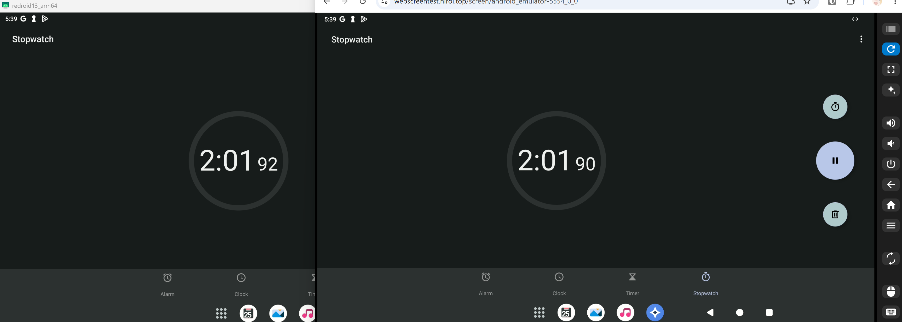

# 📺 scrmux

<p align="center">
  <a href="https://github.com/huonwe/scrmux/releases"></a>
  <a href="https://github.com/huonwe/scrmux/stargazers"></a>
  <!-- <a href="https://hub.docker.com/r/dukihiroi/scrmux"></a> -->
  <a href="https://github.com/huonwe/scrmux/commits/main"></a>
  <a href="https://www.gnu.org/licenses/agpl-3.0"></a>
</p>
<p align="center">
  
  
  
  
</p>

**Turn any browser into an AI-enhanced universal remote screen.**  
Stream **Android**, **GameStream (Sunshine/Wolf)**, **Linux Desktops**, and **RK3588 HDMI-in** from a single self-hosted Go binary — supercharged with client-side **WebSR Super Resolution (Anime4K models)** and **LLM OCR Translation**.

> [!NOTE]
> **Project Renamed**: **Webscreen** is now **Scrmux** (Unified Web Screen Multiplexer).
> Existing GitHub links will automatically redirect. Please update your CLI commands, config paths, and Docker image references to `scrmux`.

[简体中文](./README.zh.md) • [日本語](./README.jp.md)

---

<!-- 💡 建议在此处直接拖入两段 5-8 秒的实机录屏（GitHub 会自动渲染为原生嵌入式视频播放器）：
     1. 浏览器内开启/关闭 WebSR 超分前后的游戏画面锐度对比
     2. 框选外语游戏/直播画面，触发 LLM OCR 实时翻译弹窗 -->
<p align="center">
  
</p>

## ⚡ Why scrmux?

Most remote streaming tools force you to juggle separate apps, suffer blurry low-bitrate streams, or manually screenshot foreign text. **scrmux unifies everything into one lightweight web interface:**

* 🔍 **Client-Side WebSR Super Resolution**: Upscale low-bitrate streams directly in your browser using WebGPU/WebGL shaders — get crisp text and sharp game graphics over bandwidth-limited networks without extra server GPU load.
* 🌐 **Instant LLM OCR Translation**: Playing untranslated games or watching foreign streams? Select any region on screen to extract and translate text on the fly via your preferred LLM endpoint.
* 🧩 **All-in-one Streaming Hub**: Manage physical Android phones, **Redroid** cloud phones, **Sunshine/Wolf** gaming rigs, headless **Linux** desktops, and **RK3588 HDMI-in** capture feeds from one unified dashboard.
* 🚀 **Zero Client Setup**: Runs natively on Linux, Windows, macOS, Docker, and **Android Termux** (`amd64` & `arm64`). Access everything via WebRTC or WebSocket from any modern browser — no client app required.

## 🎯 Built For

* **NAS & Homelab Enthusiasts**: Host Redroid cloud phones, Linux workspaces, and Wolf game streaming inside a single container on Unraid, TrueNAS, or fnOS.
* **Gamers & Stream Viewers**: Play foreign-language games or mobile titles from a desktop/tablet browser with real-time AI translation and visual upscaling.
* **SBC & Hardware Tinkerers**: Stream hardware-encoded H.264/H.265 video directly from OrangePi 5 Plus (`rk3588-hdmirx`) into any browser.

## ✨ Supported Backends & Capabilities

| Backend | Video & Audio | Input & Control | Extras |
| :--- | :--- | :--- | :--- |
| **Android (`scrcpy`)** | Low-latency H.264 / H.265 + Audio | Multi-touch (pressure), UHID Mouse / Keyboard / Gamepad | Wireless ADB pairing, Clipboard sync, Redroid ready |
| **GameStream (`Sunshine` / `Wolf`)** | Low-latency H.264 / H.265 + Audio | Mouse, Keyboard, Touch, Gamepad | Full desktop & cloud gaming support |
| **Linux (`Xvfb` / `Xorg` / `Sway`)** | H.264 / H.265 (GPU accelerated on Xorg/Sway) | Mouse, Keyboard, Touch (`uinput` / `seatd`) | Headless virtual desktop |
| **RK3588 (`rk3588-hdmirx`)** | HDMI-in via RKMPP hardware encoding | View-only | Tested on OrangePi 5 Plus Armbian vendor kernel |


## 🛠️ Prerequisites

scrmux follows a three-tier architecture: **Browser (Viewer)** ↔ **scrmux Server (Relay/Host)** ↔ **Target Devices (Remote)**.

### 1. Browser Side (Client)
* **Modern Web Browser**: Chrome, Edge, Safari, or Firefox with **WebRTC** hardware decoding support (**H.264 High Profile** or **H.265 Main Profile**).
* **HTTPS Context** *(Recommended)*: Required if you want to use **WebSR Super Resolution**, **Clipboard Sync**, or **WebSocket** streaming mode.

---

### 2. Server Side (Where scrmux Runs)
Depending on which backends you plan to host, prepare the corresponding environment on your server (Linux, Windows, macOS, Docker, or Termux):

| Target Backend | Server Requirements |
| :--- | :--- |
| **GameStream (`Sunshine` / `Wolf`)** | **Zero extra dependencies** — works out of the box with the single scrmux binary. |
| **Android (`scrcpy`)** | `adb` (`android-tools`) in your `PATH`. *(If missing, scrmux will attempt to download it automatically.)* |
| **Linux Virtual Desktop** | `xvfb`, `ffmpeg`, `xfce4`, `sway`, `wf-recorder`, and `seatd` (plus `uinput` permissions for mouse/keyboard injection). |
| **RK3588 HDMI-in** | Armbian/vendor kernel with `rk3588-hdmirx` enabled, FFmpeg with RKMPP support (e.g., `/usr/lib/jellyfin-ffmpeg/ffmpeg`), `v4l-utils`, and `sudo chmod 666 /dev/mpp_service`. |

<details>
<summary><b>📦 Quick Install & Run on Linux Servers (Debian / Ubuntu)</b></summary>

```bash
# 1. Install minimal dependency for Android streaming:
sudo apt update && sudo apt install -y adb

# Optional: Install dependencies for Linux headless virtual desktop (Xorg / Sway):
# sudo apt install -y xvfb ffmpeg xfce4 sway wf-recorder seatd

# 2. Download the latest scrmux binary (amd64) and default config:
mkdir -p scrmux/data && cd scrmux
curl -fL https://github.com/huonwe/scrmux/releases/latest/download/scrmux-linux-amd64 -o scrmux
curl -fsSL https://raw.githubusercontent.com/huonwe/scrmux/main/config.yml -o ./data/config.yml
chmod +x scrmux

# 3. Start scrmux and enable tls (visit https://<your-ip>:8081):
./scrmux --tls
```

Notes for Linux Desktop Backend:
- Xorg mode may require running scrmux as root.
- Sway mode relies on wf-recorder for screen capture.
- Input passthrough (keyboard/mouse) requires uinput kernel module and proper seatd permissions.
</details>

### 3. Target Device Side (Controlled Devices)
Android Devices: No app installation required on the phone. Simply enable Developer Options → USB Debugging or Wireless Debugging (supports pairing code).

PC / Cloud Gaming Host: Must have Sunshine or Wolf installed and running.

HDMI Source (for RK3588): Any standard HDMI output device (PC, console, camera, etc.) connected to the board's HDMI-in port.

## 🚀 Usage

### Option 1: Use Pre-built Binary

Download the latest binary from the [Releases](https://github.com/huonwe/scrmux/releases) page.

Then,
```bash
mkdir ./data
curl -fsSL https://raw.githubusercontent.com/huonwe/scrmux/main/config.yml -o ./data/config.yml
# You might need to change some settings here.
```

```bash
# Pair and connect Android devices
adb pair <your Android device IP>
adb connect <your Android device IP>

./scrmux --tls
```

Then open your browser and visit: `https://<your-ip>:8081`

### Option 2: Build from Source

Normally, you can build simply by running `make`.

> **Termux Note**: If building natively on Termux, you must run `go build -ldflags "-checklinkname=0"`.

```bash
git clone https://github.com/huonwe/scrmux.git
cd scrmux
make
```

### Option 3: Docker

```yaml
services:
  scrmux:
    image: dukihiroi/scrmux:latest
    container_name: scrmux
    network_mode: host
    restart: unless-stopped
    volumes:
      - /dev/bus/usb:/dev/bus/usb
    privileged: true
    environment:
      - TLS=true
      - IP="0.0.0.0"
      - PORT=8081

```


> 💡 **Tip:** `host` network mode is highly recommended due to WebRTC UDP traffic and USB device connection stability.

#### Android Pairing

You might need to pair your Android device via [Wireless Debugging](https://developer.android.com/studio/debug/dev-options#enable) first. "Pair device with pairing code" is supported. Once paired, click the **Connect** button in the web UI.
*Note: After starting the stream, if the screen is black, simply trigger a UI change (e.g., press the physical volume button) to force a frame update.*

---

## 📖 Documentation

* [For Developers](doc/dev)

---

## ❓ FAQ

**Q: Crash: `MediaCodec 0x80001001 Exception` on custom Android devices?**

* This is usually due to the H.264 High Profile (`profile=8`).
* **Fix**: Set `profile=1` in `video_codec_options`.

---

## 🤝 Acknowledgements

* Huge thanks to [@Enterpr1se0](https://github.com/Enterpr1se0) and [@rogniceguy-max](https://github.com/rogniceguy-max) for fixing connection bugs!

* Huge thanks to [youyoudezhuzhu/scrmux](https://github.com/youyoudezhuzhu/scrmux) for fixing agent unused sdriver resource release bugs and adding android adb manager!

* [websr](https://github.com/sb2702/websr) for use of super resolution

## 📄 License

This project is licensed under the **GNU Affero General Public License v3.0**.
