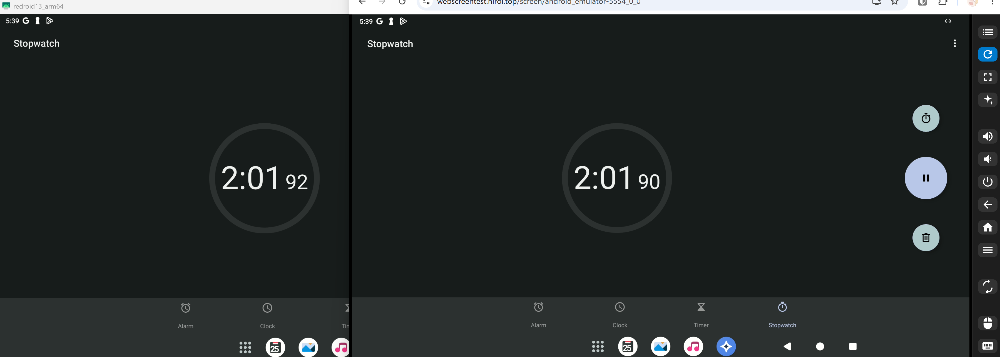

```markdown
<div align="center">

# 📺 Webscreen

一款适用于 Android, Linux, 和 GameStream 设备的自托管屏幕串流 Web 应用程序。

[](https://github.com/huonwe/webscreen/releases)
[](https://github.com/huonwe/webscreen/stargazers)
[](https://github.com/huonwe/webscreen)
[](https://www.gnu.org/licenses/agpl-3.0)

[English](README.md) • [日本語](README.jp.md)

<br/>

**[▶️ 观看演示视频 (Android)](https://youtu.be/6WtbwaIk2aY)**
**[▶️ 观看演示视频 (Orangepi5Plus HDMI 输入)](https://youtu.be/XMpHG3clOMU)**


</div>




## ✨ 功能特性

Webscreen 可在 **Android Termux**、**Linux**、**Windows** 和 **MacOS**（同时支持 `amd64` 和 `arm64` 架构）上运行，未来可能会支持更多设备！

### 通用功能
- 超分辨率（需要 HTTPS）
- H.264 / H.265 编码
- 多连接支持
- WebRTC / WebSocket 串流
> **注意**：如果选择 WebSocket，则必须使用 HTTPS。

### GameStream（[Sunshine](https://github.com/SunshineStream/Sunshine) / [Wolf](https://github.com/games-on-whales/wolf)）
- 视频、音频与控制
- H.264 / H.265 编码
- 触控、鼠标、键盘支持

### 📱 Android（基于 [scrcpy](https://github.com/Genymobile/scrcpy)）
- 视频、音频与控制
- UHID 设备（鼠标、键盘、游戏手柄）
- 剪贴板同步（需要 HTTPS）
- 触控（多指触控、压感）

> **注意**：如需 Android APK（需 Root）和 FnOS fpk 安装包，可前往查看 [youyoudezhuzhu/webscreen](https://github.com/youyoudezhuzhu/webscreen)。

### 🐧 Linux（Xvfb / Xorg / Sway）
- 视频与控制
- 触控支持
- GPU 硬件加速支持（Xorg / Sway）

### 🛹 rk3588-hdmirx（已在 OrangePi 5 Plus Armbian 官方内核上测试通过）
- HDMI 输入视频串流
- 支持 RKMPP 硬件编码的 H.264 / H.265
- *注意：暂不支持音频。*

---

## 🛠️ 前置要求

### 客户端
你需要一个支持 WebRTC（H.264 High Profile 或 H.265 Main Profile）的现代网页浏览器。

### 服务端 / 设备端
对于 Android 设备，请参考 [scrcpy 前置要求](https://github.com/Genymobile/scrcpy/blob/master/README.md#prerequisites)。

在 Windows、Linux、MacOS 和 Termux 上，你的系统环境变量 `PATH` 中至少需要包含 `adb`（在某些发行版中名为 `android-tools`，其中包含 `adb`）才能串流 Android 设备。如果程序未找到 `adb`，它会尝试自动下载。此外，如果你想使用 Linux 无头虚拟桌面，请确保 `ffmpeg`、`xvfb`、`xfce4`、`sway` 和 `wf-recorder` 均已添加到 `PATH` 中：
```bash
sudo apt install adb

# 如果你想串流 Linux 桌面：
sudo apt install xvfb ffmpeg xfce4 sway wf-recorder seatd

```

> **注意**：如果你想使用 Xorg，可能需要以 root 权限运行本程序。

> **注意**：如果你想使用 Sway，程序将调用 `wf-recorder`。

> **注意**：以上所有模式若需实现键盘和鼠标，均需要 `uinput`、`seatd` 以及相应的权限配置。

#### rk3588 HDMI 输入要求

* 支持 HDMI RX 的官方内核（已启用 `rk3588-hdmirx`）。
* 支持 RKMPP 的 FFmpeg 版本（例如 `/usr/lib/jellyfin-ffmpeg/ffmpeg`）。
* 为 MPP 服务配置正确的读写权限：`sudo chmod 666 /dev/mpp_service`。
* 安装系统软件包 `v4l-utils`。

---

## 🚀 使用方法

### 方式一：使用预编译二进制文件

从 [Releases](https://github.com/huonwe/webscreen/releases) 页面下载最新的二进制文件。默认端口为 `8079`，同时需要设置一个 6 位数的 PIN 码（若省略则默认无密码）。

```bash
./webscreen -host 0.0.0.0 -port 8080 -pin 555555

```

随后打开浏览器访问：`http://<你的IP>:8080`

### 方式二：从源码构建

通常情况下，只需运行 `make` 即可完成构建。

> **Termux 注意事项**：如果在 Termux 上进行原生编译，必须执行 `go build -ldflags "-checklinkname=0"`。

```bash
git clone [https://github.com/huonwe/webscreen.git](https://github.com/huonwe/webscreen.git)
cd webscreen
make

```

### 方式三：Docker 部署

```yaml
services:
  webscreen:
    image: dukihiroi/webscreen:latest
    container_name: webscreen
    network_mode: host
    restart: unless-stopped
    volumes:
      - /dev/bus/usb:/dev/bus/usb
    privileged: true
    environment:
      - GIN_MODE=release
      - PORT=8081
      - PIN=123456

```

> 💡 **提示：** 考虑到 WebRTC UDP 流量传输及 USB 设备连接的稳定性，强烈建议使用 `host` 网络模式。

#### Android 设备配对

你可能需要先通过[无线调试](https://developer.android.com/studio/debug/dev-options#enable)配对你的 Android 设备（支持“使用配对码配对设备”）。配对完成后，在 Web 界面中点击 **Connect（连接）** 按钮即可。
*注意：开启串流后如果画面黑屏，只需触发一次界面变化（例如按一下物理音量键）即可强制刷新画面帧。*

---

## 📖 相关文档

* [Redroid 快速入门](https://www.google.com/search?q=doc/quick-start-redroid.md)
* [开发者指南](https://www.google.com/search?q=doc/dev)

---

## ❓ 常见问题 (FAQ)

**问：在部分定制版 Android 设备上崩溃并报错 `MediaCodec 0x80001001 Exception`？**

* 这通常是由 H.264 High Profile（`profile=8`）导致的。
* **解决方法**：在 `video_codec_options` 中将参数设置为 `profile=1`。

---

## 🤝 致谢

* 非常感谢 [@Enterpr1se0](https://github.com/Enterpr1se0) 和 [@rogniceguy-max](https://github.com/rogniceguy-max) 修复了连接相关的 Bug！
* 非常感谢 [youyoudezhuzhu/webscreen](https://github.com/youyoudezhuzhu/webscreen) 修复了未使用的 sdriver 资源释放 Bug 并新增了 Android ADB 管理器！
* 感谢 [websr](https://github.com/sb2702/websr) 提供的超分辨率技术支持。

## 📄 开源协议

本项目基于 **GNU Affero General Public License v3.0** 协议开源。
